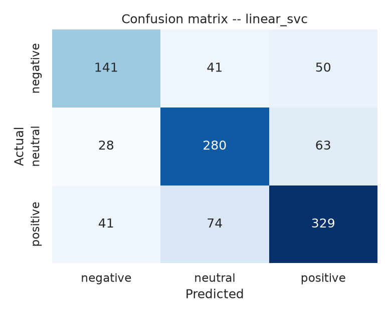

# Indonesian Tweet Sentiment & Text-Mining Pipeline

A reusable, tested NLP pipeline built from a university text-mining assignment
(Text Mining, IFM7346). The original work was two duplicated one-off notebooks:
a linear chain of cells, no functions, no tests, no evaluation, hard-coded
Colab paths. This repository turns it into an importable `src/` package with two
clearly separated case studies, a 77-test suite, and a supervised sentiment
model that is actually evaluated against a baseline.

Built with Python 3.14, pandas 3.0, scikit-learn 1.9.

---

## Headline results

Measured on 5,232 usable tweets (labels: negative 1,158 · neutral 1,855 ·
positive 2,219 — **22% / 35% / 42%, i.e. imbalanced**).

### Repeated stratified 5×3 cross-validation (15 fits per model)

| model | accuracy (mean ± sd) | **macro-F1 (mean ± sd)** | weighted-F1 | fit time (s) |
|---|---:|---:|---:|---:|
| **LinearSVC** | 0.7343 ± 0.0124 | **0.7198 ± 0.0119** | 0.7330 | 1.6 |
| Logistic Regression | 0.7297 ± 0.0125 | 0.7158 ± 0.0126 | 0.7293 | 163.5 |
| Multinomial Naive Bayes | 0.6243 ± 0.0136 | 0.5773 ± 0.0149 | 0.6045 | 1.3 |
| **Majority-class baseline** | 0.4241 ± 0.0004 | 0.1985 ± 0.0001 | 0.2526 | 1.3 |

The majority baseline is the honesty check: always predicting "positive" scores
42.4% accuracy, which is why accuracy alone (what the original notebook
reported) would be a misleading headline. The best model beats the baseline by
**+0.5213 macro-F1**.

### Held-out evaluation (stratified 80/20, LinearSVC, n = 1,047)

| metric | value |
|---|---:|
| accuracy | 0.7163 |
| **macro-F1** | **0.7039** (95% bootstrap CI [0.6760, 0.7321]) |
| weighted-F1 | 0.7154 |
| Cohen's κ | 0.5587 |

| class | precision | recall | F1 | support |
|---|---:|---:|---:|---:|
| negative | 0.6714 | 0.6078 | 0.6380 | 232 |
| neutral | 0.7089 | 0.7547 | 0.7311 | 371 |
| positive | 0.7443 | 0.7410 | 0.7427 | 444 |



**Error analysis** (297/1,047 wrong): 24.9% of errors are `positive → neutral`
and 21.2% are `neutral → positive` — i.e. the model mostly fails on the
neutral/sentiment boundary, not by inverting the polarity. Real examples are in
`results/tables/modi_error_examples.csv`.

### The preprocessing bug, measured on 2,727 real tweets

| metric | value |
|---|---:|
| total mentions in the corpus | 3,616 |
| mentions the **original** `remove_pattern` removed | 2,517 |
| **mentions it silently left behind** | **1,099 (30.4%)** |
| **tweets affected** | **627** |
| mentions the corrected function leaves | **0** |

### `np.vectorize` vs real application (54,540 rows, best of 3)

| method | ms / 1k rows | mentions left behind |
|---|---:|---:|
| `np.vectorize(remove_pattern_original)` | 1.99 | 21,980 |
| `np.vectorize(strip_mentions)` | 1.17 | 0 |
| list comprehension | 1.01 | 0 |
| `pandas .str.replace` (vectorised regex) | 17.29 | 0 |

`np.vectorize` provides no performance benefit (a plain comprehension of the
same function is ~1.15× faster). The real bottleneck in the full pipeline is
Sastrawi stemming, not vectorisation — see
[`docs/original_work_review.md`](docs/original_work_review.md).

---

## Quickstart

```bash
git clone <this-repo> && cd indonesian-tweet-sentiment-analysis
python -m venv .venv && source .venv/bin/activate
pip install -r requirements.txt
python -c "import nltk; nltk.download('stopwords'); nltk.download('punkt')"

make test     # 77 tests
make all      # regenerate every table, figure and notebook output
```

Everything under `results/` and `notebooks/` is generated; nothing is
hand-written.

| target | what it runs |
|---|---|
| `make test` | pytest suite |
| `make audit` | `scripts/01` — data audit for both corpora |
| `make novel` | `scripts/02`, `scripts/03` — preprocess + explore the Indonesian set |
| `make benchmark` | `scripts/04` — `np.vectorize` vs real application |
| `make model` | `scripts/05`, `scripts/06` — train + error-analyse |
| `make notebooks` | `scripts/07` — build **and execute** both notebooks |

---

## Repository layout

```
├── src/idtweets/            # the reusable package
│   ├── preprocessing.py     # Indonesian/tweet normalisation, fixed remove_pattern
│   ├── slang.py             # 90-entry Indonesian informal-word map
│   ├── pii.py               # contact-PII detection (governs dropped rows)
│   ├── features.py          # TF-IDF / count / char vectoriser builders
│   ├── modelling.py         # estimators, repeated stratified CV, baseline
│   ├── evaluation.py        # metrics, confusion matrices, error analysis
│   ├── io.py                # dataset loading with provenance
│   └── cases.py             # loader for the per-case modules
├── cases/
│   ├── novel-baswedan/      # case 1: preprocessing + descriptive analysis
│   └── modi-election/       # case 2: supervised sentiment classification
├── scripts/                 # numbered, runnable experiments (01–07)
├── notebooks/               # executed notebooks with embedded outputs
├── tests/                   # 77 pytest tests incl. the bug regression
├── results/                 # generated tables + figures
├── docs/                    # methodology, data card, original-work review
├── data/                    # raw datasets + the original pipeline's output
├── Makefile · requirements.txt · LICENSE (MIT) · .gitignore
```

---

## Case studies

### 1. `cases/novel-baswedan/` — Indonesian tweets, Novel Baswedan case

2,727 Indonesian tweets (86.8% retweets, 78.3% exact-duplicate texts). **No
sentiment label exists** in this dataset, so no classifier is trained on it —
claiming sentiment here would mean inventing ground truth. The case study does
what the data supports: cleaning, de-duplication (2,727 → 462 unique tweets),
hashtag concentration (top tag `#RekayasaDidzolimi`, 1,366 tweets
[/2,727]), top-term frequency, and name/entity clustering (Novel Baswedan 90.7%
of de-duplicated tweets, Jokowi 15.4%, KPK 6.3%).

Outputs: `results/tables/novel_*.csv`, `results/figures/novel_*.png`,
`notebooks/01_novel_baswedan_eda.ipynb`.

### 2. `cases/modi-election/` — English tweets, sentiment classification

The supervised case study: TF-IDF (word 1–2 grams, `min_df=2`) inside an sklearn
`Pipeline` so the vectoriser is refit per fold (no vocabulary leakage), four
estimators, repeated stratified CV, a stratified holdout, a confusion matrix and
a real error analysis. See the tables above.

Outputs: `results/tables/modi_*.csv`, `results/figures/modi_*.png`,
`notebooks/02_modi_sentiment_model.ipynb`.

---

## The three defects that were fixed

1. **`remove_pattern` stripped only the first match.** The original returned
   from *inside* its `for` loop. On the real corpus it left 1,099 of 3,616
   mentions in place across 627 tweets — a silent correctness bug that
   contaminates every downstream feature. Fixed with a single whole-string
   `re.sub`; pinned by
   [`tests/test_remove_pattern_regression.py`](tests/test_remove_pattern_regression.py),
   which asserts the old behaviour *and* the new one, and measures the impact on
   the shipped corpus.

2. **`np.vectorize` is a loop, not a vectorisation.** Replaced with three
   documented application paths (pandas `.str`, list comprehension, memoised
   `Preprocessor.map`) and benchmarked honestly in `scripts/04`. The benchmark
   reports the uncomfortable result that pandas is slower on this data rather
   than cherry-picking a number that flatters the rewrite.

3. **No evaluation.** Added a majority-class baseline, repeated stratified
   5×3 cross-validation, macro-F1 as the headline metric, a stratified holdout
   confusion matrix, a bootstrap CI, and an error analysis with real
   misclassified tweets.

Full write-up: [`docs/original_work_review.md`](docs/original_work_review.md).

---

## Data, ethics and licensing

Both datasets are **third-party tweet collections**, not collected here, and are
**not covered by this repository's MIT licence**.

* **Modi / Indian-election set** — the Kaggle **"Twitter_Data"** dataset
  (`text`, `category` ∈ {−1, 0, 1}). Reuse is governed by its Kaggle page.
* **Novel Baswedan set** — an Indonesian Twitter capture supplied with the
  coursework (no labels).
* Prefixing both: `data/` ships the raw files so the analysis is reproducible.
  If you redistribute this repository publicly, check the original data licences
  and consider dropping `data/raw/` — see
  [`docs/data_card.md`](docs/data_card.md).

**Privacy.** Five rows of the Modi corpus contain a personal phone number
(keyword-anchored or phone-shaped digit runs, `src/idtweets/pii.py`); they are
**dropped before any modelling** and the drop is counted and logged in
`results/tables/modi_data_audit.json`. The Indonesian corpus contains no
contact PII (verified). No handles, e-mails or phone numbers are reproduced in
any output; quoted misclassified examples are public tweet text only.

---

## Reproducibility notes

* Every number in this README is produced by a script under `scripts/`; none is
  typed by hand.
* Seeds are fixed (`RANDOM_STATE = 42`).
* The corpus is small (5,232 usable rows) and the corpus size is a genuine
  limitation: LinearSVC (0.7198) and Logistic Regression (0.7158) differ by
  0.004 macro-F1, which is *smaller than one fold standard deviation (0.012)*.
  The repository reports both rows and the variance rather than crowning a
  winner. See `docs/methodology.md §6` for the full limitations list.

## Test status

```
$ python -m pytest tests/ -q
77 passed
```

Covers preprocessing steps, the slang map, tokenisation/stop-words/stemming,
PII detection (including the false-positive cases it must reject), the
vectorisation comparison, the modelling layer, and the mention-bug regression.
